# Multi-Site Enterprise Network: London ⇄ Manchester

**A two-city, four-office enterprise network, designed, built and verified in Cisco Packet Tracer, with a security audit and a production roadmap.**


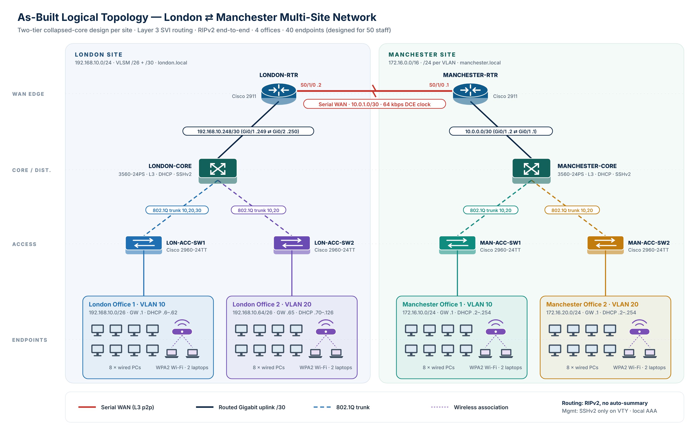

> 📄 **Full report (28 pages):** [`docs/Multi-Site_Enterprise_Network_Report.pdf`](docs/Multi-Site_Enterprise_Network_Report.pdf)
> 🧪 **Lab file:** [`packet-tracer/London_Manchester_Network.pkt`](packet-tracer/London_Manchester_Network.pkt)

---

## Contents
- [Overview](#overview)
- [Architecture](#architecture)
- [Addressing plan](#addressing-plan)
- [Key configuration](#key-configuration)
- [Verification](#verification)
- [Security audit](#security-audit)
- [Lab to production](#lab-to-production)
- [Run it yourself](#run-it-yourself)
- [Repository structure](#repository-structure)
- [Author](#author)

## Overview

A fictional company has **50 staff in four offices**: two in London and two in Manchester. They need wired and wireless access, automatic addressing, secure remote administration and reliable communication between the two cities.

| | |
|---|---|
| **Sites / offices** | 2 cities · 4 offices |
| **Network devices** | 2 × Cisco 2911 routers · 2 × 3560 L3 switches · 4 × 2960 access switches · 4 APs |
| **Endpoints** | 40 (8 wired PCs + 2 Wi-Fi laptops per office), sized for 50 staff |
| **Routing** | RIPv2, classless (`no auto-summary`), over a serial WAN |
| **Services** | Inter-VLAN routing on L3 cores · DHCP on both cores · WPA2-PSK Wi-Fi |
| **Management** | SSH only (Telnet disabled), local AAA, `enable secret`, MOTD banners |
| **Result** | 7 of 7 verification tests passed |

## Architecture

Each city uses a **collapsed core**: one multilayer switch handles both the core and distribution roles. It routes between office VLANs at hardware speed, serves DHCP and peers with the WAN router over a routed /30 link.

| Layer | Device | Role |
|---|---|---|
| WAN edge | Cisco 2911 | Inter-city routing over the serial link (Manchester is the DCE end at 64 kbps) |
| Core / distribution | Cisco 3560-24PS | SVIs for VLAN 10/20, DHCP server, RIPv2, trunk termination |
| Access | Cisco 2960-24TT | Access ports with PortFast, 802.1Q uplink, AP attachment |

<details>
<summary><b>Packet Tracer build screenshots</b></summary>

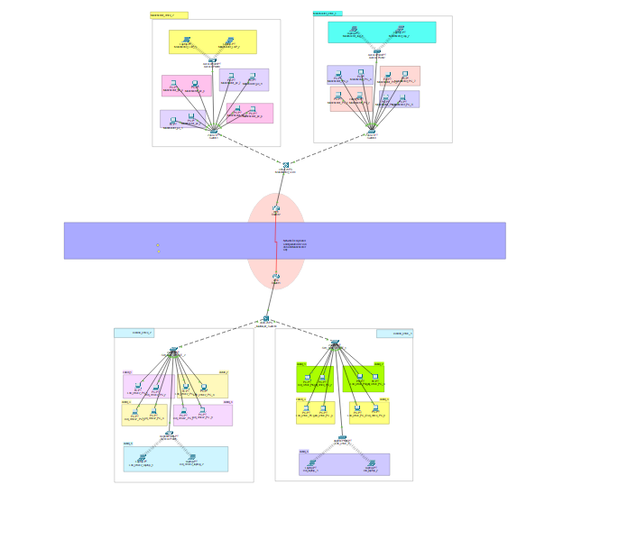
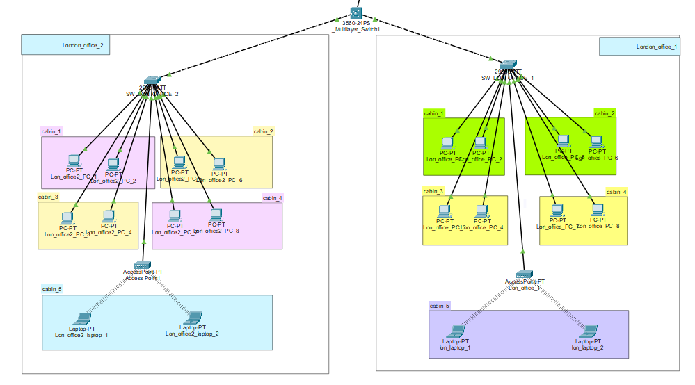
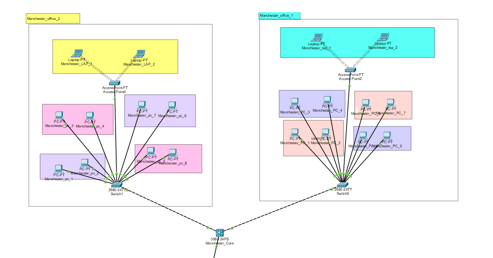
</details>

## Addressing plan

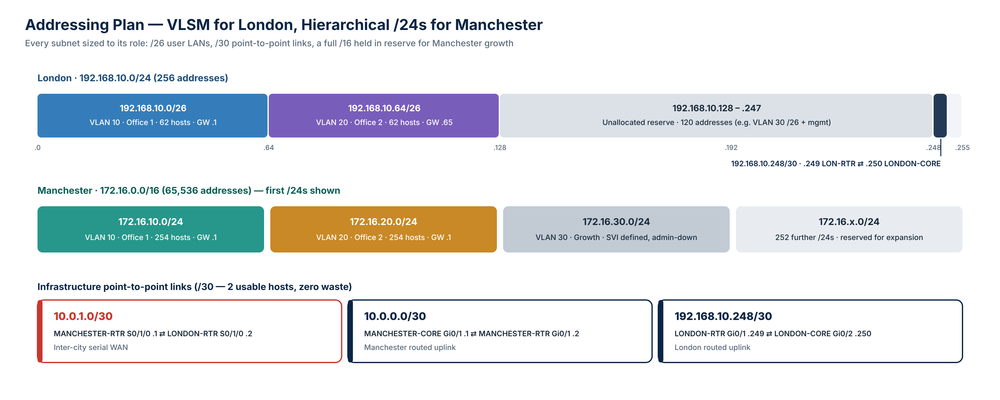

| Subnet | VLAN / office | Gateway | DHCP range |
|---|---|---|---|
| `192.168.10.0/26` | VLAN 10 · London Office 1 | .1 | .6 – .62 |
| `192.168.10.64/26` | VLAN 20 · London Office 2 | .65 | .70 – .126 |
| `172.16.10.0/24` | VLAN 10 · Manchester Office 1 | .1 | .2 – .254 |
| `172.16.20.0/24` | VLAN 20 · Manchester Office 2 | .1 | .2 – .254 |
| `172.16.30.0/24` | VLAN 30 · growth (SVI shut) | .1 | — |
| `10.0.1.0/30` | Serial WAN (MAN .1 ⇄ LON .2) | — | — |
| `10.0.0.0/30` | Manchester core ⇄ router | — | — |
| `192.168.10.248/30` | London router ⇄ core | — | — |

**Why two approaches?** London uses **VLSM**: two /26 LANs and a /30 fit inside one /24, with 120 addresses left in reserve. Manchester uses a **/16 with one /24 per VLAN**, so it can grow to many more offices without renumbering. VLAN IDs 10 and 20 are reused in both cities. That is safe because the cities are separated by a routed link, so each city's VLANs are their own broadcast domains.

## Key configuration

Full configs for all 8 devices (secrets redacted) are in [`configs/`](configs).

<details open>
<summary><b>Inter-VLAN routing + DHCP: LONDON-CORE</b></summary>

```cisco
ip routing
interface Vlan10
 ip address 192.168.10.1 255.255.255.192
interface Vlan20
 ip address 192.168.10.65 255.255.255.192
!
ip dhcp excluded-address 192.168.10.1 192.168.10.5
ip dhcp pool SW1-DHCP
 network 192.168.10.0 255.255.255.192
 default-router 192.168.10.1
```
</details>

<details>
<summary><b>RIPv2: Manchester_core</b></summary>

```cisco
router rip
 version 2
 network 10.0.0.0
 network 172.16.0.0
 no auto-summary   ! keeps /26, /24 and /30 prefixes intact across the WAN
```
</details>

<details>
<summary><b>SSH-only management: Manchester_core</b></summary>

```cisco
ip domain-name manchester.local
username admin secret <redacted>
crypto key generate rsa
ip ssh version 2
line vty 0 4
 exec-timeout 5 0
 login local
 transport input ssh
```
</details>

## Verification

| # | Test | Result |
|---|---|---|
| T1 | Core-to-core ping (LONDON-CORE ⇄ Manchester_core) | ✅ 5/5 |
| T2 | Inter-city PC ping 192.168.10.73 ⇄ 172.16.10.7 | ✅ 0 % loss, TTL 124 |
| T3 | Packet path trace in simulation mode | ✅ expected 7-hop path |
| T4 | SSH London PC → Manchester_core | ✅ |
| T5 | SSH Manchester PC → LONDON-CORE | ✅ |
| T6 | `show ip route` on both cores: all remote prefixes learned via RIP | ✅ |
| T7 | DHCP leases in both cities | ✅ |

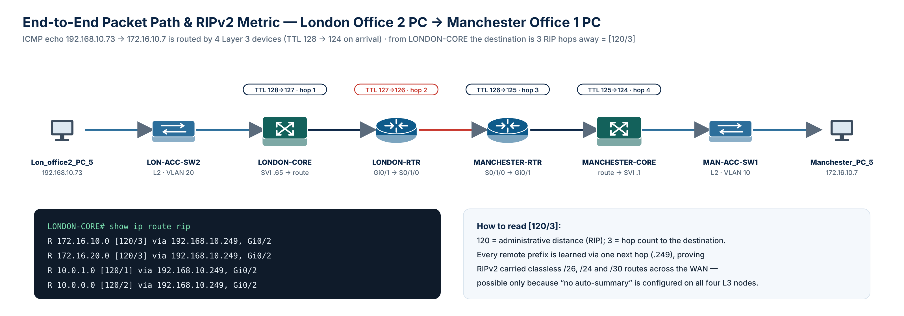

**Reading the evidence:** a return TTL of **124** means four Layer 3 devices each decremented the starting TTL of 128. The RIP metric of **[120/3]** on LONDON-CORE for the Manchester LANs matches the three routed hops in the topology.

<details>
<summary><b>Verification screenshots</b></summary>

| | |
|---|---|
| 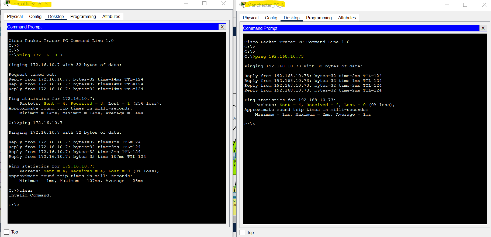 | 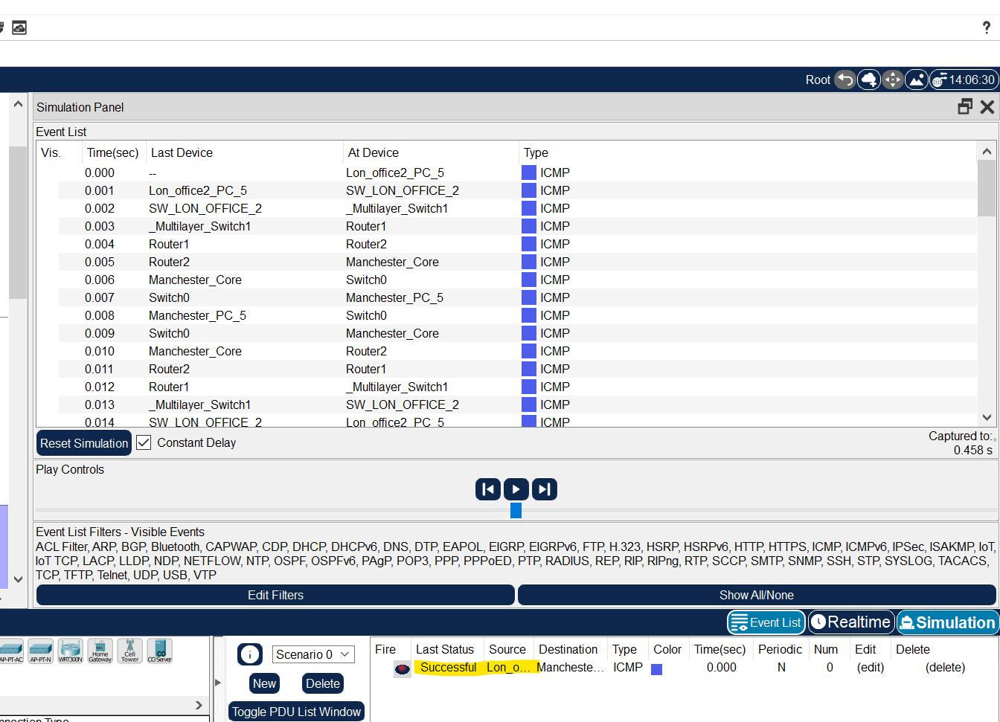 |
| 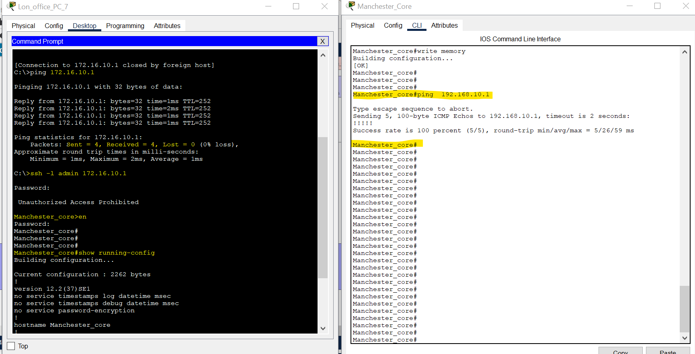 | 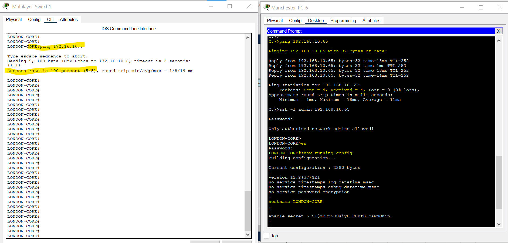 |
| 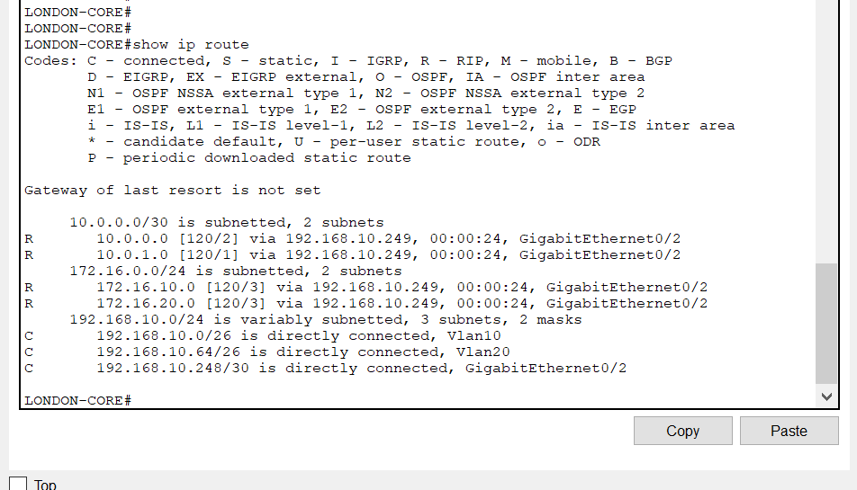 | 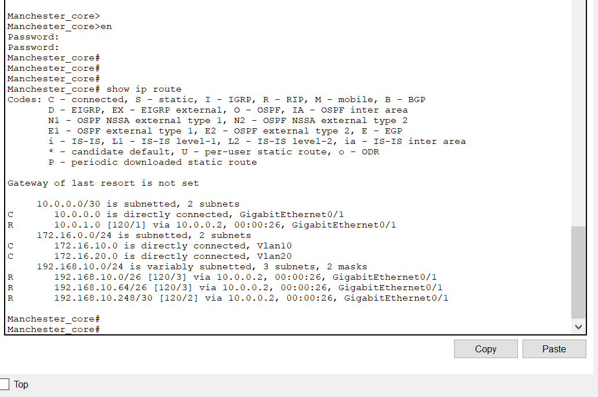 |
| 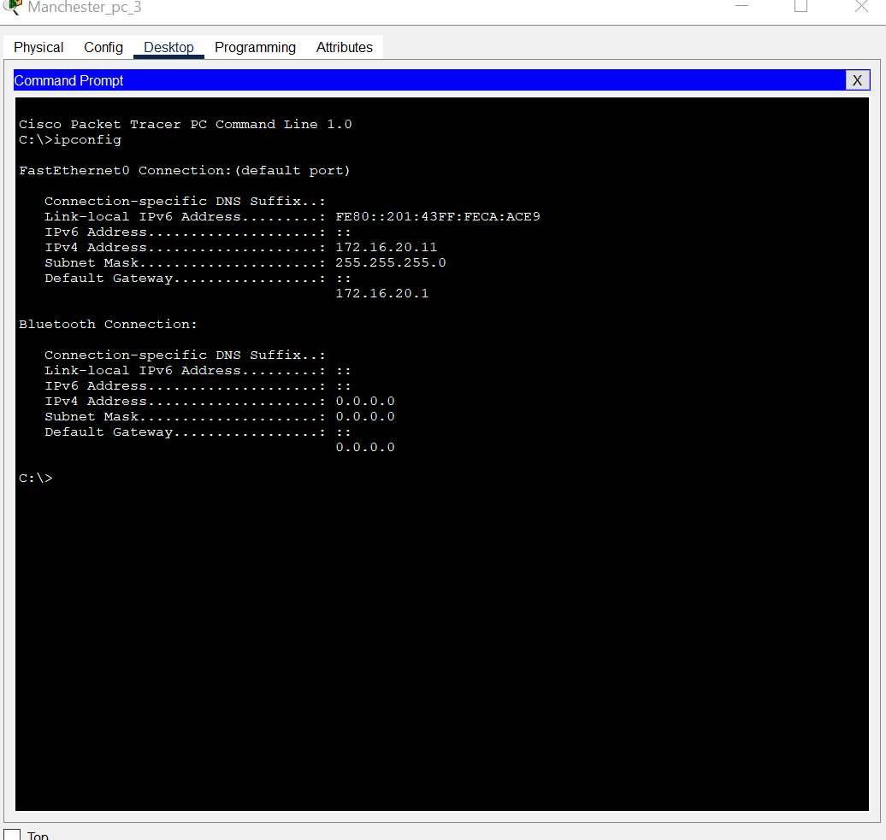 | 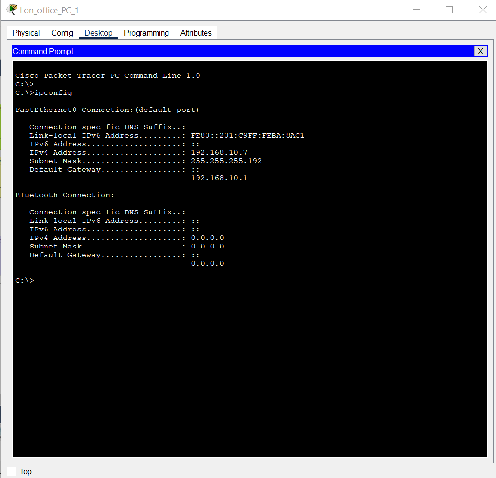 |
</details>

## Security audit

The running configurations were reviewed against the CIS Cisco IOS Benchmark. The lab already has SSH-only access, hashed enable secrets, pruned trunks, shut unused ports and a disabled VLAN 1 SVI. The audit also found the gaps below, which would need fixing before a real deployment:

| Risk | Finding | Fix |
|---|---|---|
| 🔴 High | Plaintext console password on London devices | `service password-encryption`, `login local` |
| 🔴 High | RIP updates are unauthenticated | MD5 key-chain or OSPF with authentication |
| 🔴 High | No ACL restricting who can reach VTY lines | `access-class` limited to a management subnet |
| 🔴 High | Single 64 kbps WAN link | Dual WAN (MPLS + IPsec VPN) |
| 🟠 Medium | Manchester DHCP pools overlap switch SVIs (.2) | Exclude .1 – .9 |
| 🟠 Medium | No port-security, DHCP snooping, DAI or BPDU guard | Enable on all access ports |
| 🟡 Low | DTP-negotiated trunks, native VLAN 1, SSHv2 not enforced on 2 devices, unreachable DNS | `nonegotiate`, unused native VLAN, `ip ssh version 2`, internal DNS |

## Lab to production

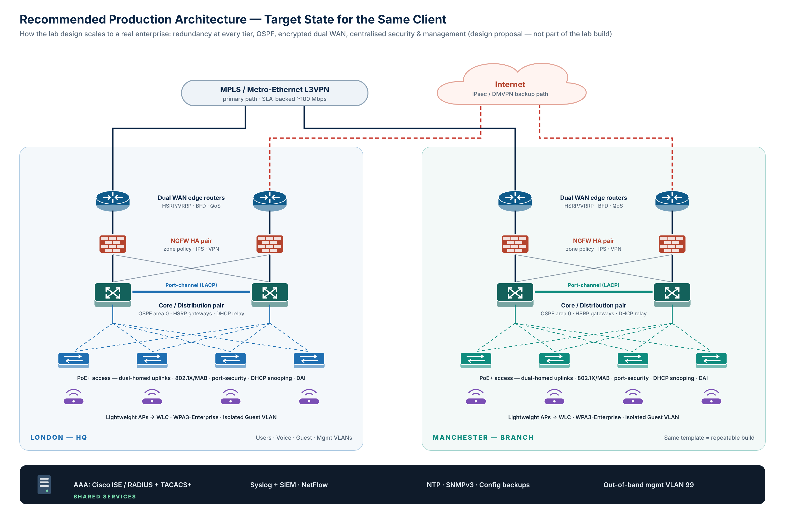

A five-phase roadmap (hardening → OSPF/HSRP/dual WAN → NGFW edge → 802.1X/WPA3-Enterprise → SIEM/NetFlow/SNMPv3) is detailed in section 9 of the report.

## Run it yourself

1. Install **Cisco Packet Tracer 8.2+** (free through Cisco Networking Academy).
2. Open `packet-tracer/London_Manchester_Network.pkt`.
3. Wait about 60 s for STP and RIP to converge, or use *Fast Forward Time*.
4. If a PC shows `169.254.x.x`, go to *Desktop → IP Configuration* and select **DHCP** again.
5. Try it: `ping 172.16.10.1` from a London PC, `ssh -l admin 192.168.10.65` from a Manchester PC, and `show ip route` on either core.

> Lab credentials are for simulation only. Never reuse them on real equipment.

## Repository structure

```
├── packet-tracer/   London_Manchester_Network.pkt
├── configs/         running-configs for all 8 devices (secrets redacted)
│   ├── london/
│   └── manchester/
├── diagrams/        architecture, addressing, packet-path and production diagrams (PNG + SVG)
├── screenshots/     build and verification evidence
└── docs/            full technical report (PDF)
```

## Author

**Muhammad Sohaib Rafiq**: Cyber Security student (Air University, Islamabad), working on secure network design, malware analysis and threat detection.

🔗 LinkedIn: *[add your profile URL]* · Feedback and collaboration welcome. Open an issue or connect.

---
<sub>Topics: cisco · packet-tracer · ccna · networking · vlan · vlsm · rip · inter-vlan-routing · dhcp · ssh · network-security · network-design</sub>
